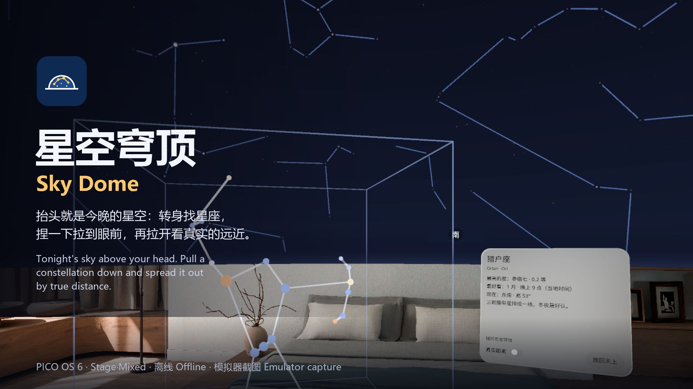
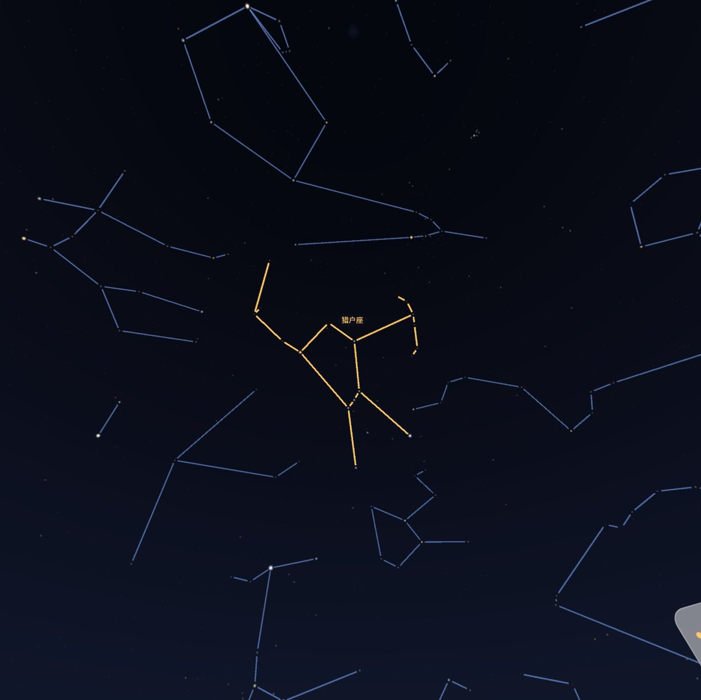
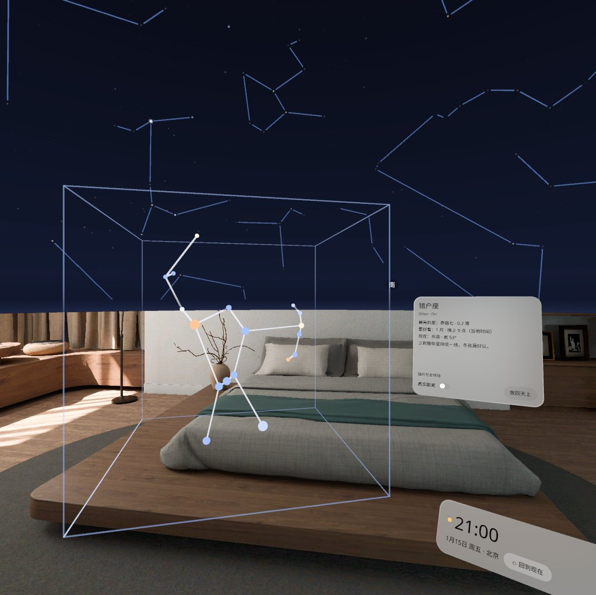
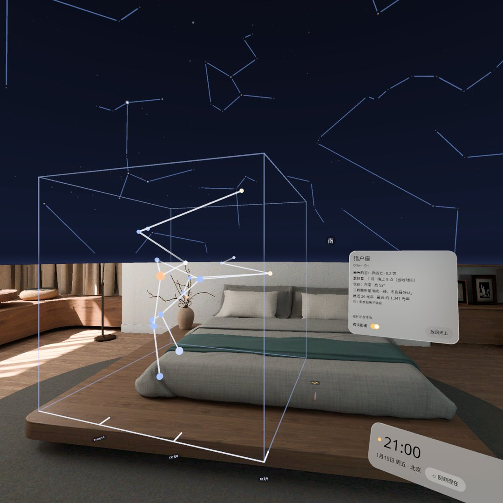
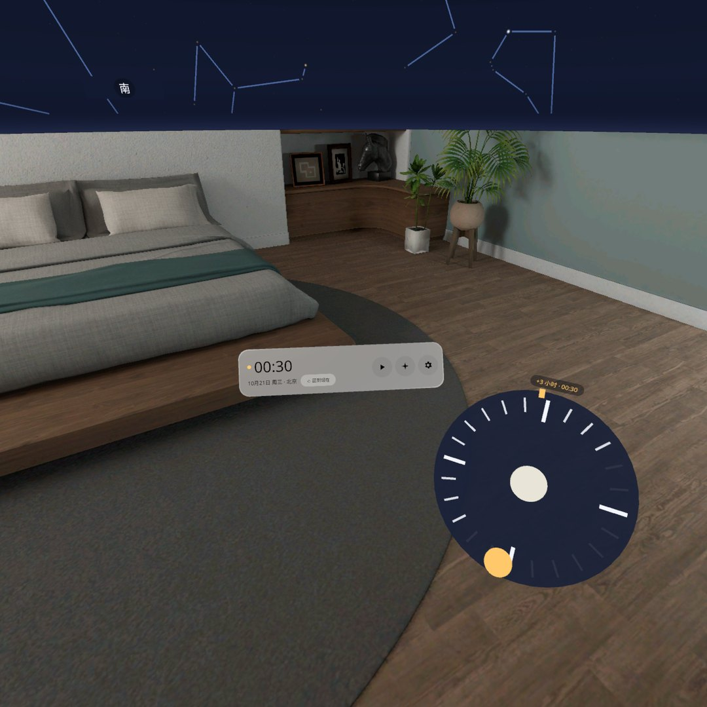
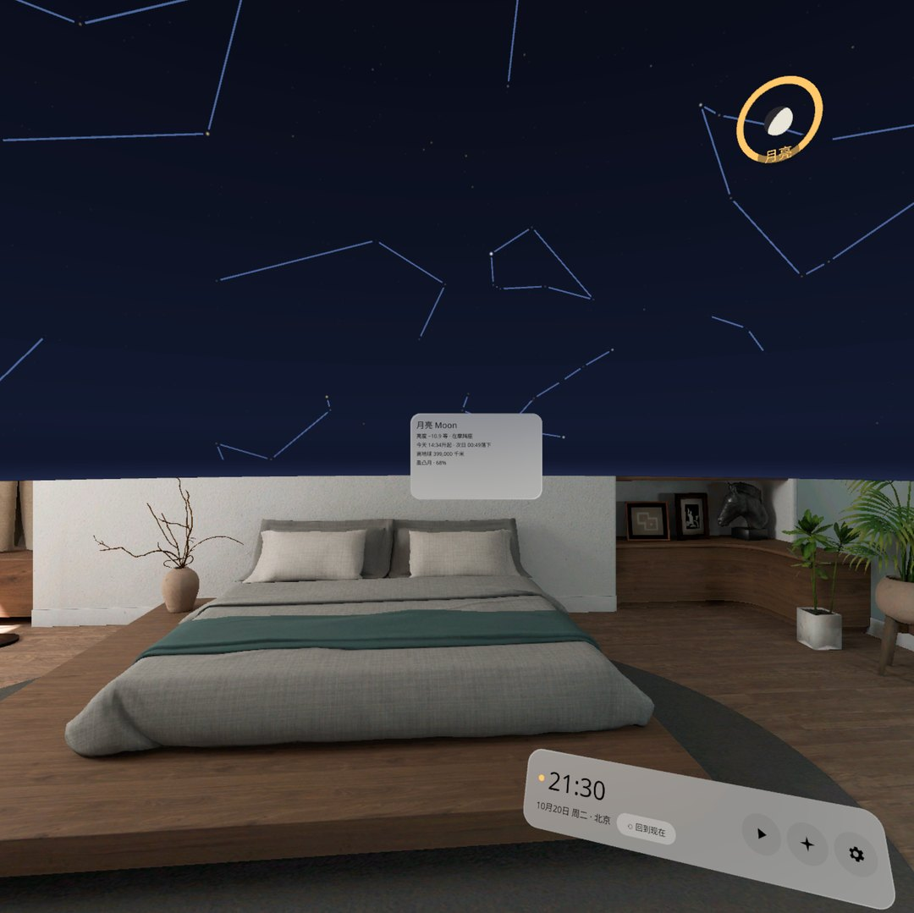
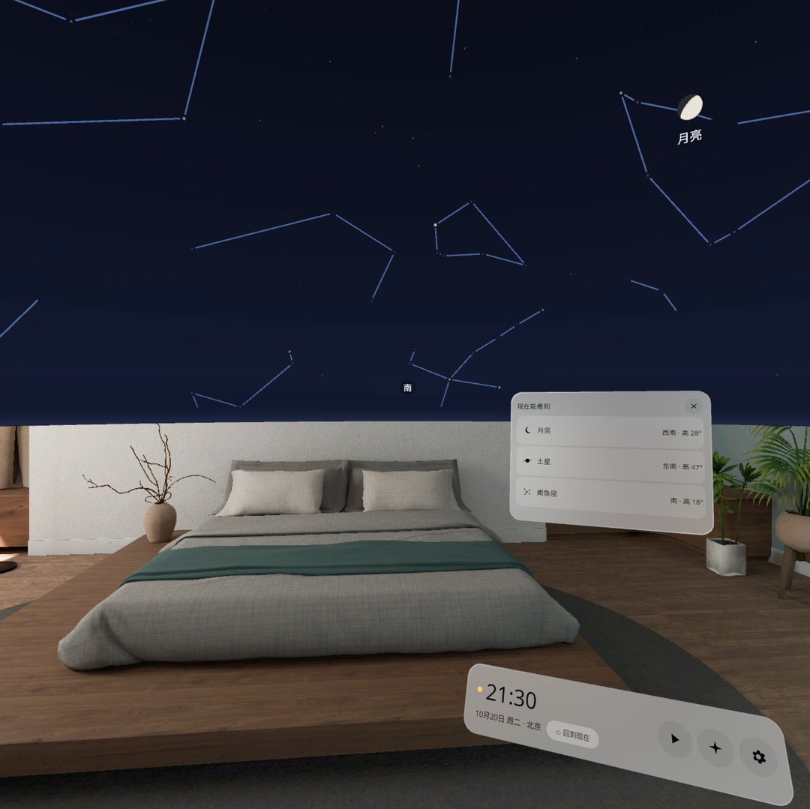

# 星空穹顶 Sky Dome


抬头就是今晚的星空。上半个视野变成一座不透明的星空穹顶，地平线以下还是你自己的房间；转身、抬头去找星座，看着它就亮起名字，捏一下把它拉到眼前变成一个 3D 模型，再打开「真实距离」，星星按它们离我们的远近前后散开。手边一个 24 小时时间盘，转一圈天空跟着转一天。PICO OS 6 应用，Stage · Mixed（可切全黑 Stage · Full），全程离线。

Tonight's real sky above your head. The upper half of your view becomes an opaque star dome while the room stays visible below the horizon. Turn and look up to find a constellation; it lights up with its name as you look at it. Pinch to pull it down in front of you as a 3D model, then switch on "true distance" and its stars spread out by how far away they really are. A 24-hour dial by your hand turns the sky. An app for PICO OS 6 (Stage · Mixed, with an all-dark Stage · Full option), fully offline.



> **当前状态 / Status (v0.1.1)**
>
> - 只在 PICO 6.1 模拟器上验证过（QA 两轮，34 个状态截图，黑块测试 720 张连续黑 0 次）。已装到头显，但还没戴上看过：**真机效果依赖真机验证**（见下文「真机依赖」）。Verified on the PICO 6.1 emulator only (two QA rounds, 34 state screenshots, 0 consecutive black frames in 720). Installed on a headset but not yet looked at: **device behaviour depends on a device check** (see "Device-dependent" below).
> - 截图和视频都来自模拟器，由调试命令和模拟器输入驱动，**不是真实手势录像**。Screenshots and video come from the emulator, driven by debug commands and injected emulator input. **This is not a recording of real hand gestures.**
> - **星表和星座连线的许可待确认**（见「数据来源与许可」）。**The licences of the star catalogue and the constellation figures are pending confirmation** (see "Data sources and licences").

## 截图 Screenshots

| | |
| --- | --- |
|  |  |
| **看着猎户座**：视线停在星座上 0.3 秒，连线变琥珀色、上方出现名字。Look at Orion: after 0.3 s its lines turn amber and its name appears. | **捏一下拉下来**：猎户座飞到眼前 0.9 m，变成 3D 模型，右边挂着星座卡（最亮的星、什么时候最好看、现在在哪个方向）。Pinch: Orion flies down to 0.9 m as a 3D model with its card. |
|  |  |
| **真实距离**：星星按对数刻度前后散开（10–5,000 光年 → 0–0.5 m），底边有 10 · 100 · 1,000 光年刻度。True distance: stars spread on a log scale, with 10 · 100 · 1,000 ly ticks. | **拨时间盘**：转一圈 = 24 小时，读数显示「+3 小时 · 00:30」，跨过午夜日期自动加一。Time dial: one turn = 24 h; crossing midnight moves the date. |
|  |  |
| **月亮卡**：捏月亮或行星，近处出现天体卡（亮度、在哪个星座、升落时刻、月相），天上那颗外圈亮起圆环。Body card: brightness, constellation, rise and set, phase. | **今晚看点**：最多 4 条（月亮、最亮的两颗行星、本月的一个星座），点一条就有箭头带你转过去。Tonight: up to four picks; tap one and an arrow leads you there. |

演示视频 Demo video: [docs/media/SkyDome-demo.mp4](docs/media/SkyDome-demo.mp4)（60 s，PICO 模拟器，调试输入驱动，无声，**非真实手势录像** / emulator, debug-driven, silent, not real gestures）：北京今晚的星空 → 快进 → 拉下猎户座 → 摇杆转动 → 真实距离侧视 → 月亮卡 → 今晚看点。

## 怎么用 How it works

1. 打开应用，先说你正面对哪边（北 / 东 / 南 / 西，用手机指南针看一眼最准），按「就是这边」；不知道就点「不知道，先看看」，北签会标「北（演示）」。Tell it which way you face (a phone compass helps) or skip for a demo heading.
2. 头顶是所选城市此刻的星空：5,041 颗 6 等以内的星、88 个星座连线、太阳、月亮和 5 颗肉眼可见的行星；地平线以下不画任何东西。The sky of the chosen city right now: 5,041 stars, 88 figures, sun, moon, five planets; nothing below the horizon.
3. 看着一个星座 → 它亮起名字；捏一下 → 拉到眼前。卡上可以打开「真实距离」，用手柄摇杆左右或捏住拖动转它，「放回天上」送回去。Look, pinch, turn it with the thumbstick or by dragging, put it back.
4. 手边条：时间（点一下选日期和城市）、▶ 快进（1 秒 = 10 分钟）、✦ 今晚看点、⚙ 设置。手边的时间盘拖一圈 = 24 小时。Hand bar: time and place, fast-forward, tonight, settings; the dial turns the day.
5. 设置里可以关掉连线、行星和月亮、东南西北，切「全黑」（看不到房间），重新指北，切中文 / English。Settings: layers, all-dark, find north again, language.

36 个离线城市（国内 24 + 海外 12），时间按城市当地时间显示。不需要网络、定位、相机或任何权限，没有账号，没有 API key。36 built-in cities in their local time. No network, location, camera or any permission; no account, no API key.

## 安装 Install

```bash
adb install -r SkyDome-v0.1.1.apk
pico-cli app launch io.embodit.skydome
```

APK 在 [Releases](../../releases) 里（debug 签名）。The APK is attached to the release (debug-signed).

## 构建 Build

```bash
./gradlew assembleDebug
adb install -r app/build/outputs/apk/debug/app-debug.apk
```

Needs the PICO Spatial SDK 6.1.9 and JDK 21. 15 JVM tests: `./gradlew testDebugUnitTest` (planets within 0.3° of JPL Horizons, moon within 1°, Polaris at the latitude, the Southern Cross over Sydney, catalogue distances). Developer notes, debug commands and the screenshot tour: [AGENTS.md](AGENTS.md).

## 已知问题 Known issues (v0.1.1)

来自 QA 第 2 轮，都不挡使用。From QA round 2; none blocks use.

1. 正视拉下来的星座时，星座卡贴在视野右边缘，稍微转头就完整。Looking straight at the pulled-down model, its card sits at the right edge of the view; a small head turn shows it whole.
2. 引路箭头是直箭头（设计是弯箭头），方向是对的。The guide arrow is straight (the design has a curved one); its direction is right.
3. 时间盘盘心是实心圆（设计是小月牙 / 太阳图标）。The dial centre is a plain disc, not a moon / sun glyph.
4. 指北面板下半部分空着。The lower part of the heading panel is empty.
5. 拨过时间后再回中，「方向变了 · 重新指北」芯片按设计优先级让位给「回到现在」，只剩「北？」签提示。After the time is changed, a recenter only shows as the "N?" tag (the chip slot is taken by "back to now", by design priority).
6. 模拟器上冷启动到星空出现约 12 秒（设计预计 < 1 秒），真机待测。About 12 s from cold start to the sky on the emulator; to be measured on a device.
7. 弹窗刚出现的第一帧偶尔下半截没画完，下一帧恢复（模拟器瞬时帧，两轮各 1 / 720 张）。A popup's first frame is sometimes half drawn on the emulator (1 in 720), fixed on the next frame.
8. 应用内「关于」还没有 suncalc 的 BSD-2 版权声明全文（全文在本 README 末尾和 [third_party/suncalc/LICENSE](third_party/suncalc/LICENSE)），上架前补进应用。The in-app About does not yet carry suncalc's full BSD-2 notice (it is at the end of this README and in third_party/suncalc/LICENSE); to add before a store release.

## 真机依赖 Device-dependent

这些只能戴上头显看。These need a headset:

- 手柄摇杆左右转动拉下来的星座（模拟器读不到手柄，只用调试输入验证过）。Turning the model with a real thumbstick (the emulator does not report the controller).
- 星空和真实指南针 / 时间对不对得上；6 m 穹顶像不像远处的天；全黑模式观感。Whether the sky matches a real compass and the time; whether the 6 m dome reads as a far sky; the all-dark look.
- 眼动对准（现在用头部正前方代替）、系统回中事件、半躺时手边条的位置。Eye-gaze targeting (the head direction stands in), recenter events, the hand bar when half lying.
- 冷启动耗时；名签和卡片文字在真机分辨率下读不读得清；5,000 颗星的帧率。Cold start time; legibility of tags and cards; frame rate with 5,000 stars.

## 数据来源与许可 Data sources and licences

> **待确认 / Pending confirmation**
>
> 需求写的是「公有领域星表」。下表的星表都是公开、免费取得的科学星表，但 CDS VizieR 的条款原话是「科学用途免费，须引用作者与出处」，商用要看各星表的来源，**不是字面意义上的公有领域**。星座连线是本项目对照 IAU 星座图手录的，靠署名「IAU 与 Sky & Telescope」使用。**商用 / 上架前请确认这两点。**
>
> The brief asked for public-domain star data. The catalogues below are public and free to obtain, but CDS VizieR's terms read "free for scientific use; cite the authors and the publication"; commercial use depends on each catalogue's origin. **That is not literally public domain.** The constellation figures were recorded by this project against the IAU constellation charts and are used with the attribution "IAU and Sky & Telescope". **Please confirm both before any commercial or store release.**

Everything in `app/src/main/assets/sky/` is generated by `tools/make_data.py` from the files in `tools/data/` (fetched 2026-10-22 by `tools/fetch_data.sh`). No Stellarium, HYG or d3-celestial data file is used.

| 内容 What | 来源 Source | 许可 / 条款 Licence / terms | 用途 Used for |
|---|---|---|---|
| 5,041 颗 V ≤ 6.0 的星（+ 2 颗连线暗星）5,041 stars (+ 2 fainter figure stars) | **XHIP**, Extended Hipparcos Compilation, Anderson & Francis 2012, Astron. Letters 38, 331 (CDS VizieR **V/137D**) | CDS 公开星表；科学用途免费、须引用作者与出处（本 README 与应用「关于」已引用）；商用视来源而定，XHIP ReadMe 未写其他限制；基于 ESA Hipparcos 新归算（I/311）。Public CDS catalogue; free for scientific use with citation; commercial use depends on origin. **待确认 pending** | 位置、星等、B−V 颜色、视差与误差、距离（pc × 3.2616 = 光年） |
| ξ UMa（HIP 55203，XHIP 无此行）| 位置来自 CDS **IV/27A**，V 与 B−V 来自 Hipparcos **I/239**（ESA 1997）| 同上 as above | 北斗一条腿上的一颗星 |
| Bayer / Flamsteed → HIP | HD-DM-GC-HR-HIP-Bayer-Flamsteed Cross Index, Kostjuk 2002 (CDS **IV/27A**) | 同上 as above | 解析手录连线；没有专名的最亮星显示希腊字母 |
| 88 个星座连线（571 段）88 figures (571 segments) | 本项目对照 **IAU 星座图**（IAU 与 Sky & Telescope）手录，见 [tools/lines-source.md](tools/lines-source.md) | 「哪颗星连哪颗星」是事实记录；署名「IAU and Sky & Telescope」（IAU 天文教育办公室改编版星座图为 CC BY 4.0）。Facts recorded by this project, attributed. **待确认 pending** | 星座连线 |
| 星座边界 Boundaries | Roman 1987, *Identification of a Constellation from Position* (CDS **VI/42**) | CDS 条款同上 | 天体卡「在双子座」 |
| 行星位置 Planets | JPL *Keplerian Elements for Approximate Positions of the Major Planets* (Standish), table 1, 1800–2050 | 美国政府（NASA/JPL）公开资料 US government public information | 水星至土星 |
| 行星星等 Magnitudes | Mallama & Hilton 2018 | 已发表论文的公式 published formulas | 天体卡亮度、今晚看点排序 |
| 太阳与月亮 Sun and moon | **suncalc** 公式（V. Agafonkin，BSD-2-Clause；Meeus 低精度项）移植为 Kotlin，加月亮站心修正 | BSD-2-Clause（全文见下）| 日月位置、月相 |
| 星座名、星名 Names | 英文：IAU 名与 IAU WGSN 星名；中文：《天文学名词》与传统星名，本项目录入 | 事实 facts | 卡片与名签 |
| 星座一句话 One-liners | 本项目自写 written by this project | 自有 own text | 星座卡 |
| 城市 Cities | 36 个城市，坐标取到 0.01°，IANA 时区 | 事实 facts | 时间和地点 |
| 字体 Fonts | Noto Sans, Noto Sans SC（子集）| SIL OFL 1.1 | 全部面板 |

建议致谢 Suggested acknowledgement: "This research has made use of the VizieR catalogue access tool, CDS, Strasbourg, France (DOI 10.26093/cds/vizier)."

### suncalc (BSD-2-Clause)

```
Copyright (c) 2014, Vladimir Agafonkin
All rights reserved.

Redistribution and use in source and binary forms, with or without modification, are
permitted provided that the following conditions are met:

   1. Redistributions of source code must retain the above copyright notice, this list of
      conditions and the following disclaimer.

   2. Redistributions in binary form must reproduce the above copyright notice, this list
      of conditions and the following disclaimer in the documentation and/or other materials
      provided with the distribution.

THIS SOFTWARE IS PROVIDED BY THE COPYRIGHT HOLDERS AND CONTRIBUTORS "AS IS" AND ANY
EXPRESS OR IMPLIED WARRANTIES, INCLUDING, BUT NOT LIMITED TO, THE IMPLIED WARRANTIES OF
MERCHANTABILITY AND FITNESS FOR A PARTICULAR PURPOSE ARE DISCLAIMED. IN NO EVENT SHALL THE
COPYRIGHT HOLDER OR CONTRIBUTORS BE LIABLE FOR ANY DIRECT, INDIRECT, INCIDENTAL, SPECIAL,
EXEMPLARY, OR CONSEQUENTIAL DAMAGES (INCLUDING, BUT NOT LIMITED TO, PROCUREMENT OF SUBSTITUTE
GOODS OR SERVICES; LOSS OF USE, DATA, OR PROFITS; OR BUSINESS INTERRUPTION) HOWEVER CAUSED
AND ON ANY THEORY OF LIABILITY, WHETHER IN CONTRACT, STRICT LIABILITY, OR TORT (INCLUDING
NEGLIGENCE OR OTHERWISE) ARISING IN ANY WAY OUT OF THE USE OF THIS SOFTWARE, EVEN IF
ADVISED OF THE POSSIBILITY OF SUCH DAMAGE.
```

## 许可 Licence

本仓库代码为专有（私有仓库）；内置字体 Noto Sans / Noto Sans SC 为 SIL OFL 1.1（[third_party/](third_party/)）；数据的来源与条款见上表。Code: proprietary (private repository). Fonts: SIL OFL 1.1. Data: see the table above.
